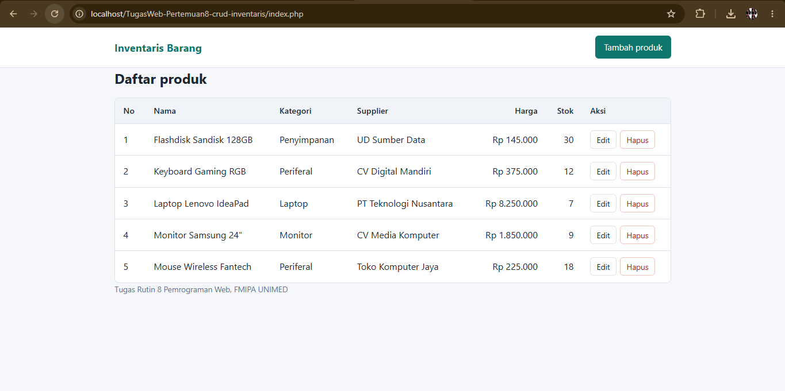
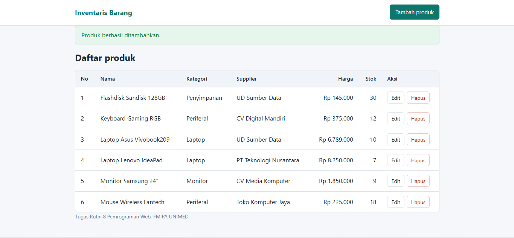
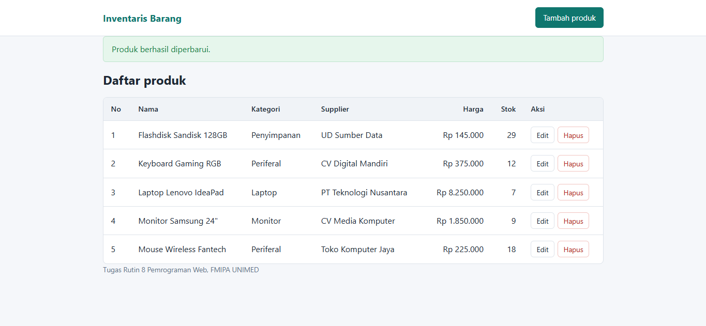
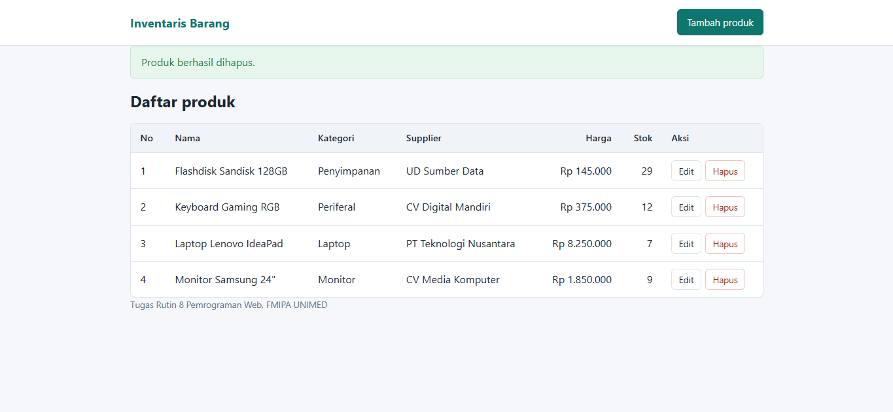

# CRUD Inventaris (Tugas Rutin 8 Pemrograman Web)

Ini adalah aplikasi CRUD untuk mengelola data inventaris barang.
Project ini dibuat menggunakan PHP Native, PDO, dan MySQL.

## Fitur

Beberapa fitur yang ada di aplikasi ini yaitu:

- Menampilkan daftar barang yang sudah terhubung dengan kategori dan supplier.
- Menambahkan data barang baru melalui form.
- Memilih kategori dan supplier menggunakan dropdown.
- Mengedit data barang yang sudah ada.
- Menghapus data barang dengan konfirmasi terlebih dahulu.
- Menampilkan pesan berhasil atau gagal setelah melakukan proses.

## Keamanan

Untuk keamanan, pada project ini saya menggunakan:

- Prepared statement untuk query yang menggunakan input dari user.
- `htmlspecialchars()` untuk mengamankan output yang ditampilkan ke halaman.
- PDO dengan `ERRMODE_EXCEPTION`.
- Menggunakan `FETCH_ASSOC`.
- `EMULATE_PREPARES` diatur menjadi `false`.

## Cara Menjalankan

Untuk menjalankan project ini, langkah-langkahnya yaitu:

1. Nyalakan Apache dan MySQL di XAMPP.
2. Masukkan folder project ke dalam folder `htdocs`.
3. Buka phpMyAdmin.
4. Pilih database yang digunakan, lalu import file `schema.sql`.
5. Cek file `config/database.php` dan sesuaikan username serta password MySQL jika diperlukan.
6. Setelah itu buka project melalui browser dengan alamat:

`http://localhost/nama-folder-proyek/`

## Screenshot

### Daftar Barang

### Tambah Barang

### Edit Barang

### Hapus Barang

